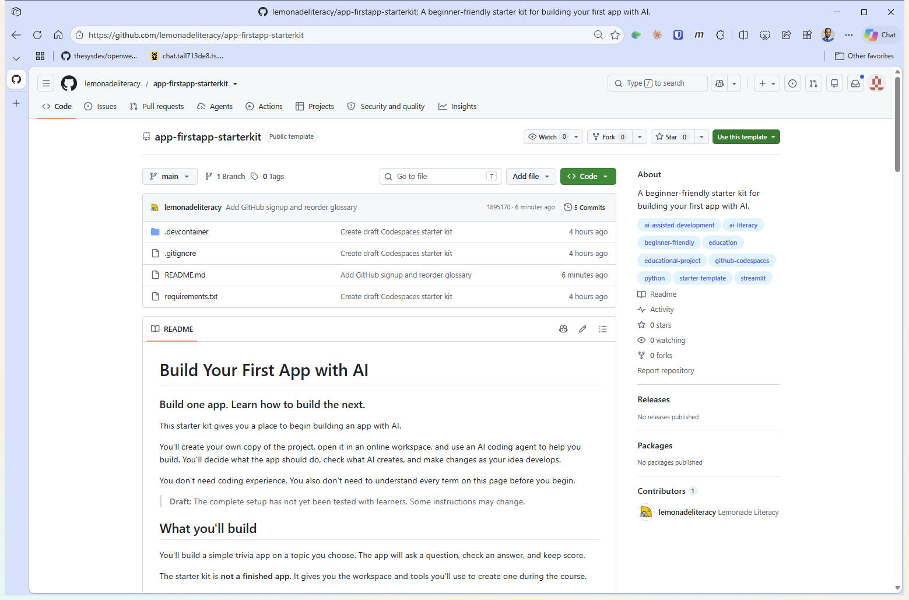

# Build Your First App with AI

### Build one app. Learn how to build the next.

This starter kit gives you a place to begin building an app with AI.

You'll create your own copy of the project, open it in an online workspace, and use an AI coding agent to help you build. You'll decide what the app should do, check what AI creates, and make changes as your idea develops.

You don't need coding experience. You also don't need to understand every term on this page before you begin.

## What you'll build

You'll build a simple trivia app on a topic you choose. The app will ask a question, check an answer, and keep score.

The starter kit is **not a finished app**. It gives you the workspace and tools you'll use to create one during the course.

## Your four sessions

| Session | Turning point | What you'll do |
|---|---|---|
| **1** | **Decide** | Choose what your app should do and begin building its first version. |
| **2** | **Connect** | Connect your app to a public information source. |
| **3** | **Check** | Test the results, identify problems, and direct AI to fix them. |
| **4** | **Shape** | Customize your app and check that your changes work. |

Each session is planned to be recorded and shared afterward. **Dates, times, and session length are to be confirmed.**

## Before you begin

You'll need:

- A computer and an internet connection.
- An eligible [GitHub account](https://github.com/).
- Access to GitHub Codespaces, the online workspace used for the course.
- An eligible account for either **Codex** or **Claude Code**, with access to its coding extension.

Some services have usage limits or costs. Review the current terms before subscribing or adding payment information:

- [GitHub Codespaces billing](https://docs.github.com/en/billing/concepts/product-billing/github-codespaces)
- [Codex pricing](https://developers.openai.com/codex/pricing)
- [Claude Code setup](https://code.claude.com/docs/en/vs-code)

### A note about age and accounts

Each service has its own age and consent rules. Check the current terms before creating an account.

GitHub requires users to be at least 13, or the applicable local minimum. [OpenAI's individual terms](https://openai.com/policies/terms-of-use) require users under 18 to have a parent or guardian's permission; access to the Codex IDE extension for teen accounts still needs to be verified. [Anthropic's consumer terms](https://www.anthropic.com/legal/consumer-terms) require users to be at least 18, or older where local law requires.

Use your own eligible account. Don't share credentials or create an account with a false age.

## Set up your building space

Try these steps before the first session. If you get stuck, note where you stopped and ask the course organizer for help.

### 1. Set up a GitHub account

If you already have your own eligible GitHub account, you can skip to the next step.

1. Go to [GitHub](https://github.com/) and select **Sign up**.
2. Follow the prompts to create your account and verify your email address.
3. Choose a strong password and keep it private. Don't share your password or verification codes with anyone, including the course organizer or your AI agent.
4. Sign in to GitHub.

Check the age and account rules above before signing up. If you need a parent or guardian's help, ask them before creating your account. For help with account security, see [GitHub's guide to securing your account](https://docs.github.com/en/authentication/keeping-your-account-and-data-secure/securing-your-account).

### 2. Create your own repository

A **repository**, or *repo*, is where your project files and their saved history live.

1. Open the [starter template](https://github.com/lemonadeliteracy/app-firstapp-starterkit).
2. Select **Use this template → Create a new repository**.
3. Choose your own GitHub account as the owner.
4. Give your repository a name, such as `my-first-app`.
5. Select **Private**, then **Create repository**.

Want a guided walkthrough? Select the image above to open it.

You now have your own copy. Changes you make to it won't change the course starter.

### 3. Open your repository in Codespaces

A **Codespace** is an online workspace where you can work on your project.

1. On your new repository page, select **Code → Codespaces**.
2. Select **Create codespace on main**, or the equivalent create button.
3. Wait for the editor to open and the environment to finish setting up.
4. Open **Explorer** and check that you can see your project files.

### 4. Connect an AI coding agent

An **AI coding agent** can help you understand and change project files. Choose either Codex or Claude Code, subject to the account rules above.

1. Open **Extensions** in your Codespace.
2. Search for your chosen extension:
   - [**Codex** by OpenAI](https://marketplace.visualstudio.com/items?itemName=openai.chatgpt) — `openai.chatgpt`
   - [**Claude Code** by Anthropic](https://marketplace.visualstudio.com/items?itemName=anthropic.claude-code) — `anthropic.claude-code`
3. Install the extension in the Codespace if it is available.
4. Open its panel and sign in with your own eligible account.

**Important:** These extension steps have not yet been tested in the course's browser-based Codespace. If an extension doesn't install or start, ask the organizer for help. Don't disable security settings or share credentials to get around the problem.

### Don't have a coding agent? Try OpenCode (optional)

[OpenCode](https://opencode.ai/) is a free, open-source tool for working with AI coding agents. You can find its [OpenCode extension in the Visual Studio Marketplace](https://marketplace.visualstudio.com/items?itemName=sst-dev.opencode). It may still require an account with an AI model provider, and that provider may have its own costs and account rules.

OpenCode is another option, not a requirement for the course. Install it in your Codespace only if it is available there. Never put an API key, token, password, or other credential in your repository or a project file.

### 5. Ask your first question

Once the agent is open in your project, try:

> I'm learning to build my first app. Explain only the tracked starter files `README.md`, `requirements.txt`, `.gitignore`, and `.devcontainer/devcontainer.json` in beginner-friendly language. Don't read secrets, credentials, environment files, or untracked files. Don't change or run anything.

Compare the answer with the files you can see. If the agent asks to change files or run a command, decline for now.

### 6. Explore more questions (optional)

Looking for a head start? We'll cover these topics during the sessions, but you can explore them with your coding agent before the first session. You don't need to do this to be ready.

If you're curious, ask one question at a time:

- **Python:** "What is Python, and what role will it play in my app? Explain it for a beginner."
- **Streamlit:** "What is Streamlit? Explain how it turns Python code into something I can see in a browser."
- **Git and GitHub:** "What is the difference between Git and GitHub? Use an analogy, then explain how each relates to this project."
- **Repositories:** "What is a repository, and how is my copy different from the course starter?"
- **Saving work:** "Explain commit, push, and pull using a simple example. Don't make any changes."
- **APIs:** "What is an API? Explain how an app might use one to get trivia information."

After an answer, you can ask:

> Give me a short example and one question I can use to check my understanding.

Compare the answers with the course instructions and ask follow-up questions. For this exploration, ask the agent not to run commands or change files. Don't approve a command or change unless you understand and want it.

### Local and cloud: where does your app run?

An app can run **locally**, on your own computer, or in the **cloud**, on a computer accessed over the internet. In this course, your Codespace is a cloud workspace: you use it through your browser to build and run your app.

Running an app in your Codespace lets you preview it while you work. **Hosting** is making an app available for people to access, often using a separate cloud service. A Codespace preview is not the same as publishing an app for everyone.

If you're curious, ask your agent:

> What's the difference between running an app locally, running it in my Codespace, and hosting it online? Explain it for a beginner. Don't run commands or change files.

## Get familiar with the language

This glossary is optional. You don't need to memorize it—come back whenever you encounter an unfamiliar term.

| Term | What it means |
|---|---|
| **GitHub** | Where your project repository lives. |
| **Repository / repo** | Your project's files and their saved history. |
| **Template** | A starting set of files you copy into your own repository. |
| **Codespace** | An online workspace for working on your project. |
| **AI coding agent** | An AI tool that can help you understand and change project files. |
| **Commit** | A saved checkpoint of changes in Git. |
| **Push** | Send committed changes from your workspace to GitHub. |
| **Pull** | Bring changes from GitHub into your workspace. |

Files in your Codespace are **not automatically committed and pushed** to GitHub. We'll practise saving your work during the course.

## Are you ready?

Before the first session, check:

- [ ] I created my own private repository from the starter.
- [ ] I can open the repository in a Codespace and see its files.
- [ ] I checked the account rules and costs for my chosen agent.
- [ ] My agent can describe the starter files.
- [ ] I know how to ask for help if I get stuck.

You can find and reopen your workspace at [github.com/codespaces](https://github.com/codespaces). Stop it there when you're finished; closing your browser tab may not stop it immediately.

## Keep your information private

Use only public or made-up information in your project.

**Never enter personal, confidential, or client information, passwords, API keys, or tokens into prompts or project files.**

A private repository is not a place to store secrets. The included `.gitignore` file excludes some common secret files, but it cannot catch everything or prevent an AI agent from reading a file.

### Work safely with your coding agent

Before you approve an agent's request to run a command or change files, read what it plans to do. Ask questions if you don't understand it. You can say no, ask it to explain, or ask it to make a smaller change.

Don't disable security settings or copy credentials into the project to make a tool work. If a setup step asks for that, stop and ask the organizer for help.
